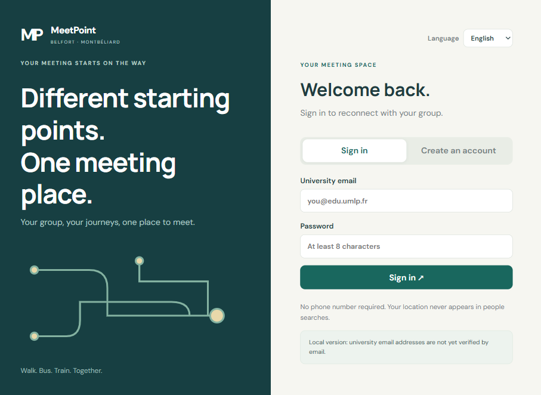

# MeetPoint

**MeetPoint** is a multilingual mobility web application that helps groups choose a suitable meeting place and plan individual journeys by walking, bus and train.

<p align="left">
  <a href="https://revolution-arbor-card-atlanta.trycloudflare.com/" target="_blank">
    <strong>Open the live project</strong>
  </a>
</p>

<p align="center">
  
</p>

Built for the **Mobility in Smart Cities** mini-project at Belfort-Montbéliard.

## Highlights

- Accounts and private group meetings
- English and French interface
- Meeting-place catalogue with hours, capacity and permission data
- Individual availability and allowed travel modes
- Timetable-aware bus and train planning
- Separate departures for each participant
- Map view for origins, destinations and routes
- Group chat and optional location sharing
- Profile photos and Android WebView package
- Docker and local Windows startup support

## Overview

MeetPoint compares the available meeting places and returns a proposal for the group. It considers participant availability, meeting duration, transit schedules, walking access, transfers and the selected travel objective.

The course algorithm is also demonstrated separately through a Dijkstra implementation for static shortest paths and OD costs.

## Quick start

### Windows

1. Install Python 3.11 or newer.
2. Open the project folder.
3. Double-click `START.cmd`.
4. Visit [http://localhost:8000](http://localhost:8000).

For a terminal-only start:

```powershell
py -3 start.py
```

### Linux or macOS

```bash
python3 start.py
```

Dependencies are installed automatically when needed.

## Run with Docker

```bash
docker compose up --build
```

Open [http://localhost:8000](http://localhost:8000).

## Technology

| Area | Technology |
|---|---|
| Backend | Python, FastAPI, Uvicorn |
| Database | SQLite |
| Frontend | HTML, CSS, JavaScript |
| Maps | Leaflet |
| Transit data | GTFS |
| Android shell | Java, Android WebView |
| Testing | Pytest |
| Deployment | Docker Compose |

## Project structure

```text
app/
  main.py          FastAPI application and APIs
  planner.py       Meeting and itinerary planning
  graph.py         Dijkstra and OD calculations
  gtfs.py          Timetable/feed processing
  walking.py       Walking-route handling
  venues.py        Meeting-place catalogue
  static/          Web interface
android/           Android WebView project and APK
data/              Imported feeds and project data
docs/              Course requirements and documentation
scripts/           Data download and verification tools
tests/             Automated test suite
```

## Tests

```powershell
.\\.venv\\Scripts\\python.exe -m pytest -q
```

Tests use temporary databases and should not modify the local application database.

## Data and limitations

- The included timetable data is a project snapshot and should not be treated as live operator data.
- Live disruptions and service updates are not integrated.
- Map tiles and optional walking verification require internet access.
- Opening hours and meeting-place permissions are stored data, not guaranteed reservations.
- Indoor navigation code is present, but verified floor-plan data is not supplied.
- Location sharing depends on browser consent and HTTPS or localhost geolocation support.

## Documentation

- [Start guide](START_HERE.txt)
- [Course requirements](docs/COURSE_REQUIREMENTS.md)
- [Validation report](VALIDATION.md)
- [Android guide](android/README.md)
- [Data status](data/DATA_STATUS.md)

## Author

MeetPoint was developed for the Mobility in Smart Cities course.
