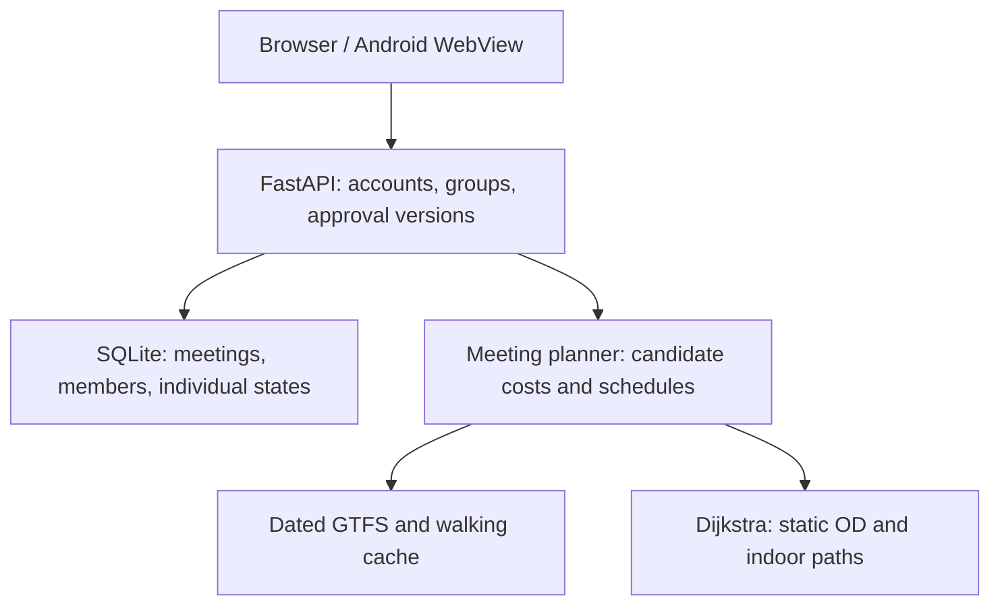

# MeetPoint / PointCommun - Complete Project Handoff

**Version 0.5.0 - 10 November 2026**  
**Course:** Mobility in Smart Cities, Philippe Canalda  
**Project:** Optimizing Emergency Indoor & Outdoor Navigation and Meeting-Point Detection & Tracking

This is the complete project folder, combining the previous full release and all five later application updates with the new planning changes. Send the entire ZIP to your friend. No previous patch ZIPs are needed.

## 1. Start here - Windows

1. Install **Python 3.11 or newer** from [python.org](https://www.python.org/downloads/windows/). Enable the Python launcher during installation.
2. Extract the ZIP completely. Open the extracted `MeetPoint` folder.
3. Double-click **`START.cmd`**.
4. Open **http://localhost:8000** in your browser. Keep the terminal open.

The first start downloads the Python dependencies and creates `.venv`. Subsequent starts reuse that environment. Stop the server with **Ctrl+C**.

**Only start the application once.** Stop any older MeetPoint server first so port 8000 does not show the old version. The API health endpoint `/api/health` must show version `0.5.0`.

If you prefer a terminal, open it in this folder and run:

```powershell
py -3 start.py
```

This avoids PowerShell script execution-policy problems. Do not open `app/static/index.html` directly: the interface needs its Python server.

On Linux/macOS:

```bash
python3 start.py
```

Python 3.12 was used for this revision's automated checks. Dependencies are pinned to the versions tested here.

## 2. Use the application

1. Create your account and sign in. English displays **MeetPoint**; French displays **PointCommun**.
2. Open **Meeting places**. Add or edit actual places, including their entrance, permission, capacity and known opening hours.
3. Use **Use this place in meeting calculations** to enable or disable a place. Unknown opening hours are not treated as verified availability.
4. Create a meeting: title, date, duration, objective and preferred place type.
5. Invite registered friends by name. People searches do not show their starting locations.
6. Each person accepts the invitation, selects their own starting point, gives availability and chooses allowed transport modes.
7. Save each person's journey details. **There is no walking-time input. Walking durations are calculated automatically.**
8. The organizer selects **Calculate**. The application compares feasible candidates and returns **one recommendation**.
9. Read the meeting time and each person's **Leave at**, arrival and journey duration. Expand individual routes to inspect stops and transfers.
10. Everyone approves the same proposal. Confirmation does not start everybody's journey.
11. Each person can select **I'm leaving** or **I've arrived** independently. Location sharing is optional and must be enabled by that person.

**Available from** means the earliest time you can leave, not an instruction to leave at that time. The optional attendance window specifies when you can attend the meeting. If left blank, the entered availability window is used. The boarding margin has a default; users do not need to calculate access-walking durations.

For a two-account demonstration, use two browser profiles or a normal and private window. Both must connect to the same server and database.

## 3. What changed in this version

| Change | Implemented behavior |
|---|---|
| One recommendation | All admitted catalogue candidates are compared; only the winning proposal is returned to the normal interface |
| Individual departures | A reverse timetable search finds a latest feasible departure for each person to reach the selected meeting |
| Automatic walking times | The old maximum-walking-time form input is removed, including its language-switch state handling |
| Faster calculation | Parsed dated networks, participant query rows and arrive-by results are cached with bounded cache sizes |
| Fewer repeated external calls | Normal Calculate uses valid cached walking data and estimates where data is missing; it makes no new pedestrian-router calls |
| Optional pedestrian verification | **Verify walking routes (slower)** explicitly requests network verification/refinement; changed walking costs trigger timetable re-search |
| Geometry work | Detailed transit geometry is materialized for the winning candidate; losing candidates do not all generate detailed map routes |
| Editable candidate set | Enable/disable places in the existing catalogue editor; clearly unsuitable candidates are filtered before routing |
| Independent progress | Each participant has their own scheduled/travelling/arrived state and departure display |
| Foreground departure reminder | The open meeting page can show a one-time departure reminder for the signed-in participant; it does not force others to leave |
| Approval versions | Every new calculation gets a new proposal identity; old approvals cannot approve that new plan |
| Venue changes | Relevant meetings are invalidated after place additions, edits, disabling or deletion and require recalculation/approval |
| Simultaneous calculations | Duplicate concurrent calculation for the same meeting is rejected; changed input/venue snapshots cannot publish stale results |
| Static course algorithm | Repeated Dijkstra builds recoverable shortest-path costs; exposed through an authenticated educational API |
| Indoor graph support | Supplied verified building graphs can contribute indoor walking time and instructions to the meeting plan |
| Simpler startup | One `START.cmd` / `start.py` entry point; dependency installation is repeated only when needed |
| Map dependency | Leaflet 1.9.4 is bundled locally with its licence; map tiles still require an internet connection |

The existing accounts, invitations, bilingual interface, profile photos, map picker, place management, cancellation/reopening/deletion, OD CSV export, private group chat and opt-in location sharing are retained.

## 4. Algorithms and professor alignment

### f1 - shortest paths and OD information

The professor explicitly calls the shortest-path function **Dijkstra** in Part IIIb p. 12 and Part IV p. 6. `app/graph.py` implements standard non-negative directed Dijkstra and repeated Dijkstra for an OD table, including recoverable paths. Missing connections are represented internally as unreachable, not as a negative cost.

The source also describes repeated matrix passes and prints a greater-than update that conflicts with minimization. The implementation uses cheaper-path relaxation and includes cost-1 links. The source discrepancy is documented in `docs/COURSE_REQUIREMENTS.md`; repeated matrix relaxation is not mislabelled as standard single-source Dijkstra.

Authenticated example endpoint:

```text
POST /api/graph/closure
{"matrix": [[0,1,8,-1],[-1,0,5,2],[1,-1,0,-1],[3,2,-1,0]]}
```

The expected costs are:

| From / to | 0 | 1 | 2 | 3 |
|---|---:|---:|---:|---:|
| 0 | 0 | 1 | 6 | 3 |
| 1 | 5 | 0 | 5 | 2 |
| 2 | 1 | 2 | 0 | 4 |
| 3 | 3 | 2 | 7 | 0 |

The endpoint returns route node lists as well. The same Dijkstra implementation supports supplied indoor graphs.

### Scheduled buses and trains

Actual transit planning uses the existing resource-constrained **connection-scan timetable planner**, with a reverse-time scan for arrive-by planning. It considers walking access/egress, dated services, pickup/drop-off permission, same-vehicle continuation and transfer rules. It must not be described as static Dijkstra on bus/travel durations alone.

This separation lets the project demonstrate the named static course algorithm while using timetable-aware calculations for the real multimodal interface. It does not certify that every modelling choice has been individually approved by the professor.

### f2 - group meeting selection

Part IIIb p. 13 / Part IV p. 7 asks for the point minimizing the **sum of the group's displacement costs**. The application retains a `min_total` objective and records its reference winner in `selection_evidence`.

Part I pp. 13-16 also asks for the earliest meeting. These objectives can disagree. The application offers the existing two objectives:

- **Meet as early as possible:** earliest feasible common start, then total computed journey time, then a stable venue identifier.
- **Minimise total travel time:** minimum summed duration of the computed feasible itineraries, followed by the existing time/tie criteria.

The proposed priority/tie policy is a project decision. The professor's files do not explicitly resolve the conflict between these objectives. Do not claim that one winner always optimizes both.

The transit sum is over the feasible itineraries produced by this routing model for each candidate's earliest feasible meeting. It is not a proof of minimum total travel over every possible later meeting, service combination or unmodelled location. Costs and times involving unresolved walking links remain conditional.

## 5. Why people can leave at different times

Suppose the meeting starts at 10:00, with constant journey times of 90 and 20 minutes. Suitable departures are 08:30 and 09:40, before any extra margin. Both arrive for the same meeting.

For buses/trains the application searches schedules backward from the common arrival deadline. It does not simply subtract the old displayed duration and assume that a service exists. Required interchanges remain in the itinerary. Earlier arrival and destination waiting may still be unavoidable.

The previous screenshots showed both people leaving at 08:00, then waiting 94 and 71 minutes before boarding. The new plan can delay departure from the origin when the same service remains reachable. Staying at home before the planned departure is not included in journey duration.

Acceptance confirms a proposal version. It never means that everyone has departed. Explicit journey status and shared location updates concern only the person making that update.

## 6. Performance and caching

Normal calculations do not search for city-wide points of interest or contact the pedestrian router. The app uses its saved catalogue and valid cached walking routes; unresolved walks remain estimates. Only selected route geometry is prepared for display.

Reusable data includes parsed GTFS connections, one-to-many participant costs and arrive-by query results. The query keys include the participant, enabled venues, date/time, constraints and walking costs. Changed processed-feed file versions produce a different dated network. Cached results are copied before being modified, and each new proposal receives a fresh identity.

**Measured here on the included two-person reference scenario:** approximately 6.9 seconds for a cold calculation and 0.06-0.14 seconds for immediate repeated calculations after cache preparation. These are observed development measurements, not a guaranteed service-level target. New origins, dates, graph changes or constraints can require a cold search. Optional pedestrian verification may take much longer because it uses a rate-limited external service.

There are 29 inherited catalogue records. Not all are eligible: permission, known hours, group size and other constraints exclude records before or during planning. Your friend can disable unnecessary records in the editor. No claim is made that all 29 are currently open or verified bookable.

Walking time is computed from a cached pedestrian route where available; otherwise the existing straight-line walking model is used and labelled approximate. The backend retains its existing 30-minute cumulative walking-resource bound as an automatic planning policy. It is not a user walking-time estimate and is not entered in the form. Developers can change the default in `Input.max_walk_minutes`; API compatibility with older clients is retained.

If you need exact pedestrian feasibility, use verified walking data and inspect the remaining approximation warnings. Fast conditional results must not be described as fully validated street-level itineraries.

## 7. Data, availability and geometry

The package includes previously imported **Evolity, Optymo and SNCF** processed timetable data, the venue catalogue, cached foot routes, rail geometry and source metadata. It does not require a large fresh GTFS download just to start.

- Transit calendars are evaluated for the requested date. If the imported feed has no service for that date, that route is unavailable; no fake trip is generated.
- The bundled feed snapshot is inherited from the earlier project. Its validity on a new date must be checked; current operator disruptions are not integrated.
- Venue permission/hours are recorded data, not a reservation. A conditional meeting still needs the indicated external booking/availability check.
- Distances may be approximate where geometry is unresolved. A general rail corridor is labelled as infrastructure geometry, not certified as the service's exact track.
- Map tiles and optional pedestrian verification need internet access. Leaflet code itself is local.
- The API supports the existing same-day availability model. Arbitrary multi-day user availability and return journeys are not implemented.
- Step-free/accessibility certification is not available; supported checks must not imply verified access that has not been supplied.

To update feeds, your friend can use the included scripts from a terminal with the project's Python environment:

```powershell
.\.venv\Scripts\python.exe scripts\download_feeds.py --refresh
.\.venv\Scripts\python.exe scripts\import_gtfs.py data\raw\evolity.zip --namespace evolity
.\.venv\Scripts\python.exe scripts\import_gtfs.py data\raw\optymo.zip --namespace optymo
.\.venv\Scripts\python.exe scripts\import_gtfs.py data\raw\sncf.zip --namespace sncf
```

Stop the server before a multi-feed import, then restart it. A nationwide SNCF feed can be large; the importer retains trips touching the configured study region. Review the original sources/licences in `data/feed_sources.json` and `data/DATA_STATUS.md`. Imported unsupported GTFS features are rejected rather than silently invented.

## 8. Indoor navigation - supported code, missing verified campus data

`data/indoor_networks.json` is intentionally empty. **No verified campus floor plan was present in the supplied project.** A tested indoor routing engine is implemented, but this release must not be presented as a validated indoor positioning/navigation deployment.

To add a real building, your friend must obtain/verify its nodes, directed edges and walking durations, then supply a graph such as the following schema. The labels and costs here illustrate the format; they are not actual university room data:

```json
{
  "building-id": {
    "verified": true,
    "nodes": {
      "entry": {"name": "Verified entrance", "floor": "0"},
      "room": {"name": "Verified meeting room", "floor": "0"}
    },
    "edges": [
      {"from": "entry", "to": "room", "seconds": 120, "bidirectional": true}
    ]
  }
}
```

Only set `verified` after checking the actual source. Node latitude/longitude can be included where verified; otherwise instructions are returned without an invented map path. Indoor edge costs must be non-negative.

A venue can reference that graph using these additional JSON/API fields:

```json
{
  "indoor": {
    "network_id": "building-id",
    "entrance_node": "entry",
    "destination_node": "room"
  }
}
```

The venue's outdoor coordinates identify its access entrance. The indoor duration is added to the journey, walking-resource budget and meeting calculation. The final route includes indoor instructions. This advanced graph mapping is configured through venue JSON/API; the normal place editor preserves extra fields when editing an existing record.

Authenticated inspection endpoint:

```text
GET /api/indoor/building-id/route?origin=entry&destination=room
```

Automatic indoor positioning is not implemented. Adding a graph alone does not turn a phone's outdoor GNSS into room-level positioning.

## 9. Architecture and files your friend should edit



| File/folder | Role |
|---|---|
| `START.cmd`, `start.py` | Normal startup; first-run dependency setup |
| `app/main.py` | Accounts, invitations, meetings, proposal calculation, independent status, authenticated APIs |
| `app/planner.py` | Candidate evaluation, forward and reverse timetable routing, departure scheduling, bounded query caches |
| `app/graph.py` | Dijkstra, static OD closure, route recovery and indoor graphs |
| `app/gtfs.py` | Feed import/service dates and cached dated networks |
| `app/walking.py` | Cached pedestrian routes and explicit optional external verification |
| `app/progress.py` | Conservative ETA/progress from consented positions |
| `app/storage.py` | SQLite schema; creates missing tables on startup |
| `app/venues.py` | Catalogue and authenticated persistent overrides |
| `app/static/` | Bilingual browser interface, map and route display |
| `data/` | Imported data, source metadata, catalogue and optional indoor graphs |
| `tests/` | Algorithm, API, UI-logic and regression checks |
| `scripts/` | Optional data import/verification utilities |
| `android/` | Existing native WebView client, APK and rebuild source |
| `docs/COURSE_REQUIREMENTS.md` | Detailed professor-source requirements/design baseline |
| `VALIDATION.md` | Checks actually performed and remaining verification limits |

The `data/meetings.sqlite3` database is created automatically. It is not included with personal accounts in this handoff. `.venv`, test databases and temporary files are not part of the archive.

## 10. Continue an existing installation

1. Stop the old server with Ctrl+C.
2. Back up the old folder, especially `data/meetings.sqlite3` and any custom data.
3. Extract this complete release into a new folder.
4. To retain existing accounts and meetings, copy your own backed-up `data/meetings.sqlite3` into the new `data` folder before starting. Copy custom indoor/feed/cache data only when you intend to keep those versions.
5. Start `START.cmd` and reload the browser. Existing tables are preserved and the new individual-state table is created automatically.
6. Recalculate older active proposals to obtain the revised departure plans. Do not assume an old stored 08:00 itinerary was rewritten merely by starting the new server.

The shared ZIP should remain free of your personal database. Do not send your real accounts, messages or precise locations to your friend unintentionally.

## 11. Android and use on another device

The web application is the supported runnable deliverable for this revision. The professor permits web or mobile; a new APK is not required in addition to the web application.

The included APK is the previously supplied native shell, not a newly built binary. It loads the interface from the configured server, so it can display this revision once connected to the updated backend. The Android source/build kit is retained. A new native build and physical-device verification were not performed here.

For a local network demonstration, start the server on your own machine with an explicit LAN binding:

```powershell
$env:MEETPOINT_HOST="0.0.0.0"
py -3 start.py
```

Connect the other device to that machine's LAN address and port, not to the phone's `localhost`. Allow only the intended local network through your firewall. Browser geolocation normally needs HTTPS or localhost; HTTP on another device may not provide location access.

For your friend to host it online, use a Python-capable server, not static-file hosting. Run one Uvicorn worker with persistent writable storage and HTTPS. A representative server command is:

```bash
python -m uvicorn app.main:app --host 0.0.0.0 --port 8000
```

For official server-running guidance, see the [FastAPI deployment documentation](https://fastapi.tiangolo.com/deployment/manually/). Use a persistent volume for `data`/SQLite or set `DB_PATH` to persistent storage. Review authentication, access rules, backups and privacy before opening this academic prototype to public users. Email ownership verification, password recovery, background mobile push and operator real-time updates are not configured. No deployment or public-access change was made in this task.

## 12. Tests and verification

After the first startup has installed dependencies, run:

```powershell
.\.venv\Scripts\python.exe -m pytest -q
```

On Linux/macOS:

```bash
.venv/bin/python -m pytest -q
```

Tests use temporary databases; do not point them at your real database. Node.js is optional for normal use. It is used by several UI-logic regression tests; those tests skip when Node is unavailable.

The revision checks include shortest-path costs, route recovery, distinct objectives, individual departures, preserved bus times and boarding margins, indoor duration integration, absence of the walking-time input, one winner, no network walking calls in fast mode, approval versions, independent journey states and venue invalidation. Previous authentication, cancellation, map-picker, progress, notification and transfer regressions are retained.

See `VALIDATION.md` for the final observed test result and verification limits. Automated checks are not a professor's grading approval or a field validation of every route.

## 13. Professor deliverables and remaining external work

The application is only one part of the submission. The supplied Moodle screenshot asks for conception/report and repository access in the first deposit, and a mini-project report, presentation and demonstration video in the project deposit. Presentation: 15 minutes maximum, 5 preferred. Video: 3 minutes, 1 minute 30 seconds preferred.

Both screenshot deposits show **30 November 2026, 23:59**. Part IV p. 63 also mentions later revision/final-project stages through Christmas/16 January; clarify staged delivery rather than assuming an extension. The exact source distinctions and optional Cybermatics bonuses are preserved in the course requirements document.

Before claiming the complete highest functional level, demonstrate real individual routes and delay/advance tracking under the stated assumptions. Obtain the actual indoor data if claiming verified indoor navigation. Record remaining approximate walking/geometry, timetable coverage, room availability and position accuracy honestly.

The final report, slides, video, real-world data verification and public hosting are not fabricated by this code handoff. Your friend can run and continue the complete source package now.
